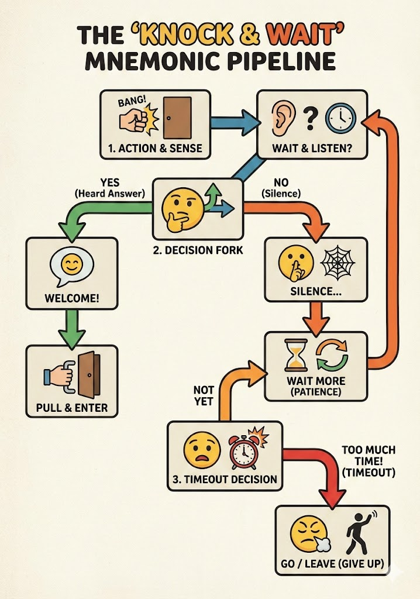

+++
title = "Nano Banana Usage"
description = "How I used Nano Banana to create a mnemonic pipeline image."
date = 2025-12-02
taxonomies.tags = [
    "Nano Banana",
    "Mnemonic",
    "Pipeline"
]
taxonomies.categories = [
    "Tools",
    "Productivity"
]
+++

I used **Nano Banana** to create this mnemonic pipeline image for my dormitory room entrance door. I don't know if it's a good idea to have this image on my door but it's fun to do. 

Here is the prompt I used:

> Create mnemonically understandable pipeline of figures shapes, maybe faces, arrows etc that describes classic situation like : bang on the door-> wait for an answer -> if yes -> pull -> if no -> wait -> if wait too much - go

> Create an image that fits on A4 paper any layout

And here is the result:

I mean, LGTM.
